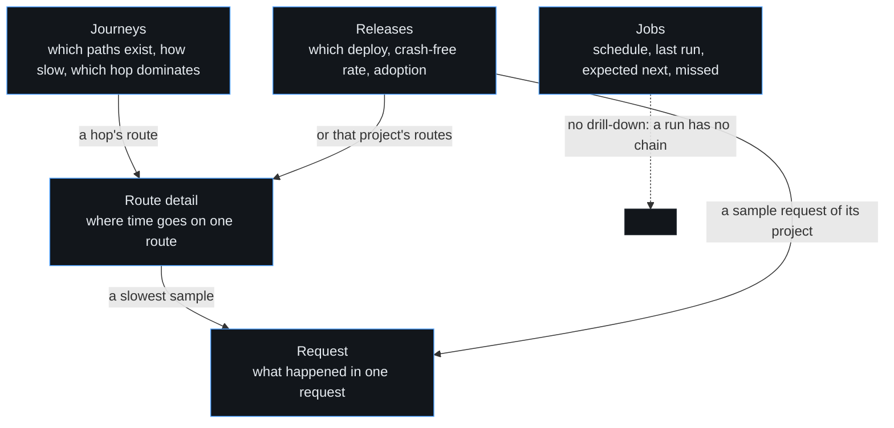

# DESIGN.md

> Rewritten for the triage-first shell (iniznet/fenrirealm-tracker#525), extended
> for the journey-first performance surface (journeys increment). The world:
> **a triage instrument** — dense, dark, and ranked. The first screen answers one
> question: *which defect, where, since when*. Server-rendered, zero runtime
> JavaScript. The stylesheet is `internal/web/static/app.css`, embedded in the
> binary and served at `/static/app.css`; the shared filter bar and hop chain
> live in `internal/web/templates/partials/hopchain.html`.

A page that breaks a rule here is a bug, not a taste difference.

## Tokens

One accent. Colour carries status and nothing else: a number is never coloured to
mean "fast", and a row is never tinted to mean "fleet".

| Token | Value | Job |
|---|---|---|
| `--bg` | `#0b0d10` | the page |
| `--surface` | `#12161b` | a table, a chip, the sticky header fill |
| `--line` | `#1f262e` | the only border in the system |
| `--text` | `#e6ebf0` | body and numbers |
| `--muted` | `#9aa6b2` | labels, units, secondary columns |
| `--accent` | `#4a9eff` | links, the focused control, the sparkline |
| `--ok` | `#3fbf7f` | a run that happened, a release that is clean |
| `--warn` | `#e0a83c` | a gap, a coverage fraction short of its total |
| `--bad` | `#e0574a` | a failure, a crash, a missed run |
| `--barh` | `92px` (`136px` under 720px) | the sticky header's offset: the two-line app bar |
| `--rowh` | `40px` | every table row, no exceptions |

The older page markup still spells `--panel`, `--border`, `--red`,
`--yellow` and `--green`. They are aliases onto the tokens above, so a
badge or a legend cannot drift into a second palette.

## Type scale — five sizes, one owner each

| Size | Token | Owns |
|---|---|---|
| 24px | `--t5` | the page title (`h1`) — the only 24px element on any page |
| 15px | `--t4` | the brand, a card title, a lead sentence |
| 14px | `--t3` | body copy, table cells, table numbers |
| 12px | `--t2` | meta: scope line, faint notes, empty states, chips |
| 11px | `--t1` | `th`, badges, control labels (uppercase) |

Rules: an `h2` is a section label at 11px uppercase — never larger than the
`h1`, never competing with it. Numbers use tabular figures and are
right-aligned in numeric columns. Monospace is reserved for ids, route patterns
and SQL: a service name is prose, not code. No size exists outside this list.

## Table rules

- **One emphasised number per row: P95.** It is the only cell at weight 650;
  everything beside it is body weight.
- **No TOTAL column.** A total answers a question about one route, so it lives in
  the route detail's Distribution section, not on an index row.
- **Sticky header, 40px rows.** The header sticks at `--barh`, the measured
  height of the two-line app bar, so it never slides under it.
- **Coverage is a fraction**, `reported/expected` — `2/3` — never a
  percentage alone. A fraction short of its total is the only cell tinted
  `--warn`.
- **A hop chain is chips separated by an arrow.** An unreported hop renders as a
  dashed chip that names the peer service and links at
  `docs/producers/<stack>.md`. It never renders blank and never renders a
  bare dash: an absence a reader can act on is the point of the page.
- **One chart.** A single 40px sparkline per journey row, and nothing else. No
  chart stands beside a number where a figure would do.
- **The filter bar is the same on all six pages**: project, service, env, range,
  entry, as a plain `GET` form. It replaces the global scope bar there and
  carries `org` as a hidden field, so the tenancy a reader arrived with is
  never dropped.
- **No JavaScript.** No script tag, no inline handler, no htmx. A page that needs
  a script to be legible is the wrong page.
- **Colour is never the only carrier.** Every actionable status prints its word
  beside the tint — `missed`, `failed`, `ok`, `not reported`, `not
  profiled` — so a reader with no colour vision reads the same page.

## Three levels, three treatments

1. **Section** — top bar, filled segment (`Now` · `Errors` ·
   `Performance` · `Releases` · `Jobs` · `Configure`). Six
   destinations, because a data surface and a config surface are different jobs.
2. **Tab** — underline, inside the page head, below the `h1`. Errors:
   Exceptions | Logs. Configure: Keys | Organisations | Settings.
   Performance: Journeys | Routes | Queries | Jobs. A route detail carries its
   own sections (Distribution, Journeys through it, Slowest samples, Queries,
   Jobs, Errors) so a reader walks from "this page is slow" to "this step is
   slow" without leaving the subject. A statement shape and a queue drain
   outlive any one route, so Queries and Jobs keep pages of their own
   (tracker #658). Each page answers one question.
3. **Page** — the `h1`, plus the scope line.

A level never borrows another level's mark. The active state is `aria-current`,
not a colour alone. A read-only surface renders no action button: the detail page
says in one line why the action does not exist instead of showing a dead control.

## Chrome

- **One sticky bar, two lines.** Destinations on line one, scope on line two,
  inside one `header.appbar`. Nothing slides under anything.
- **Scope is one control group.** Org is always present (it gates what a reader
  may see). Project, range and env render only on the sections they change —
  configuration pages show org alone, because the others do nothing there.
- **The scope is stated in words** under every `h1`: "backend · 24h ·
  production". A reader never reconstructs scope from four selects.
- **One filter form per page**, built from the shared `scopehidden` partial so
  `org` can never be dropped again. On the six performance pages the shared
  filter bar above is the one form, so those pages hide the global scope bar
  rather than render two rows that each carry half the state.
- **Drill paths carry their origin.** A row link sends `from=<list URL>`; the
  detail page's back link returns there, filters intact, and refuses an absolute
  target.

## Flow — one question per page

| Route | Page | Answers |
|---|---|---|
| `/performance` | Journeys | Which end-to-end paths exist, how slow, which hop dominates |
| `/performance/routes` | Routes | Which service's route is slow, who calls it |
| `/performance/routes/{id}` | Route detail | Where time goes on one route |
| `/performance/requests/{trace}` | Request | What happened in one request |
| `/releases` | Releases | Which deploy, crash-free rate, adoption |
| `/jobs` | Jobs | Schedule, last run, expected next, missed |

The route detail runs its six sections in the order a reader asks the questions:
Distribution, Journeys through it, Slowest samples, Queries, Jobs, Errors. The
drill-down is two steps deep and never fans out: a journey opens the route of a
hop, a route opens one of its traced samples, and a request is a leaf. A release
names a project, so it reaches a request through that project's sample; a job is
a leaf by construction, because a run has no chain to open.

## Components

- Badge: 11px, solid dark tint plus coloured text for levels. Solid, not alpha:
  a translucent fill reads as 1:1 contrast to a checker and to a low-vision
  reader.
- Chip: one service, route or hop. 12px, mono, 1px `--line` border; a service
  chip takes the one accent. A gap chip is dashed and takes `--warn`.
- Track+fill bars: 14px for waterfalls and hotspots, 6px inline in tables.
  Waterfall rows share one axis — the trace's own extent — so a nested span is
  drawn inside its parent, never beside it.
- Sparkline: server-rendered polyline, 96×24 on the landing page, 40×16 on a
  journey row, `role="img"` with a label.
- Tabs: 2px underline on `aria-current`.
- Confirm step: destructive key actions open a `
` and
  need a second press. Zero JavaScript, two deliberate clicks.
- Health footer: ingest rejections beside store figures, on every page — the
  answer to "why is my data missing?".
- Empty state: names the next action and links it. Never a dead end. Never a
  cap without saying so.
- Failure: any page-level error renders inside the shell, with a retry and a
  way back.

## The landing page answers the question

`/` opens with a ranked block: **Top defects right now** — project · defect ·
level · count · trend · last seen, ranked by pain, across every project in
scope. Project cards become a one-line strip; the aggregates below each carry a
Project column. This is the 10-second answer PRODUCT.md promises, and it is the
one place the shell spends its emphasis.

## Responsive

One breakpoint at 720px. The sticky bar keeps both lines; scope controls reach
44px on touch. Wide tables scroll inside their own box, never the page.

## Motion

Hover states only. No entrances, no scroll effects — an ops tool must not move
under an on-call reader.

## Bans

No decorative gradients, no glass beyond the sticky bar's blur, no icon fonts,
no client-side state, no light mode. Auto-refresh only on the log stream. No
two controls for one decision. No chart beside a number.

## Known gap

`docs/screenshots/*` predate this shell. Regenerating them needs a human
browser session; the file names and capture paths stay the same.
