# Docs

No site generator, deliberately. Five pages of markdown render fine on GitHub,
and adding a static-site toolchain would mean a build step, a config file and a
set of dependencies to maintain for no reader benefit. GitHub's renderer plus the
cross-links below is the docs site. Revisit that only if the page count or the
need for search makes it false.

**Hydrate-free is a product decision, not a limitation** — and the trigger for
changing it is named here so it cannot happen by accident: v1 ships zero
JavaScript. *If* live log tailing arrives and genuinely needs it, that is the
point to decide a tiny client bundle — in the open, as a decision, never as a
side effect of "it was easier with a framework". Everything else on these pages
must stay server-rendered.

| Page | Read it when |
|---|---|
| [../WIRE_SPEC.md](../WIRE_SPEC.md) | you are implementing a producer, porting a client, or asking whether a payload is legal |
| [../DEPLOY.md](../DEPLOY.md) | you are installing, exposing, upgrading or recovering an instance |
| [write-your-own-sdk.md](write-your-own-sdk.md) | you want a client for a language nobody has written one for yet |
| [producers/laravel.md](producers/laravel.md) | the producer is Laravel |
| [producers/sveltekit.md](producers/sveltekit.md) | the producer is SvelteKit or Node |
| [producers/webhook.md](producers/webhook.md) | the producer is anything else, or you just want curl |

## Screenshot gallery

Captured from a live local install of the real binary — not generated in CI. The
instance had three projects and 239 wire-spec requests posted into it, so the
pages show real aggregates rather than empty states.

| Page | Screenshot |
|---|---|
| First-run setup — `/setup`, the only open page until an admin exists | 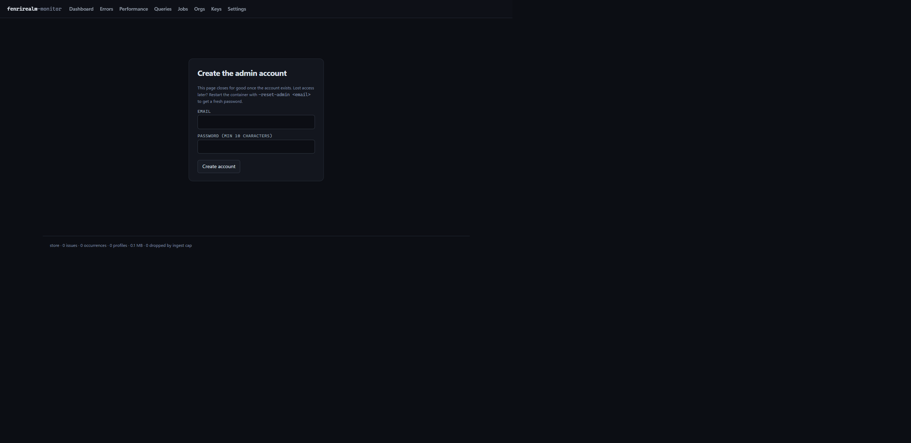 |
| Dashboard — per-project health cards + the live ingest-health strip | 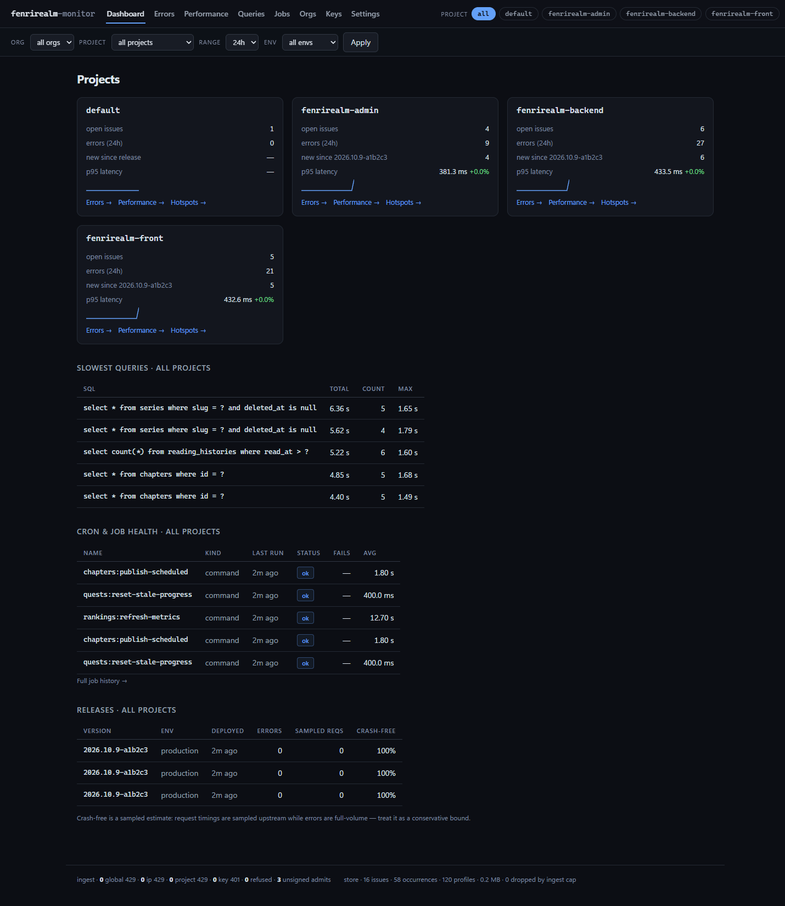 |
| Errors ▸ Issues — fingerprint groups, counts, first/last seen | 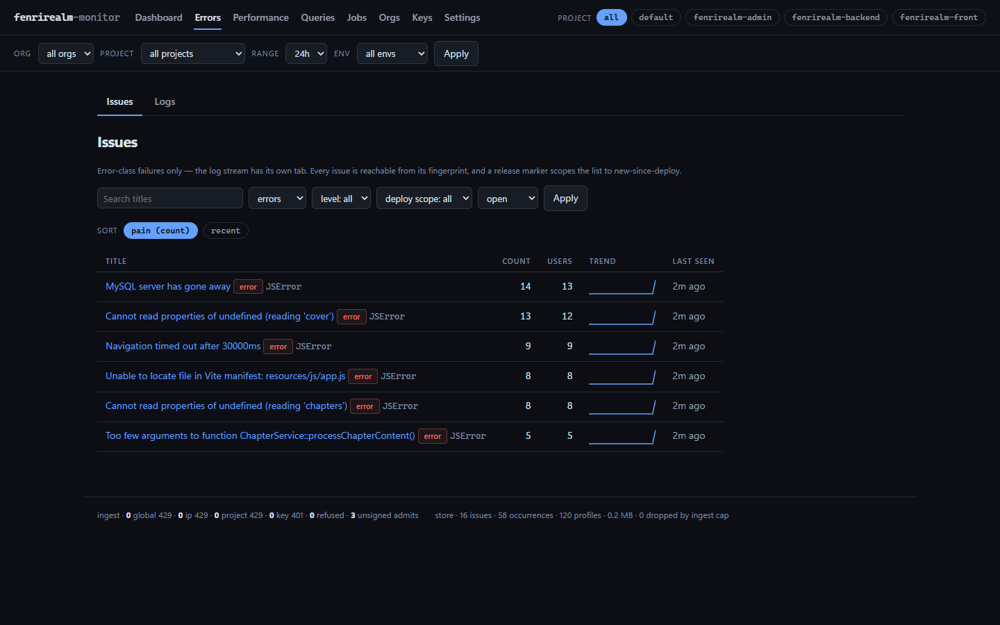 |
| Errors ▸ Logs — channel/level stream | 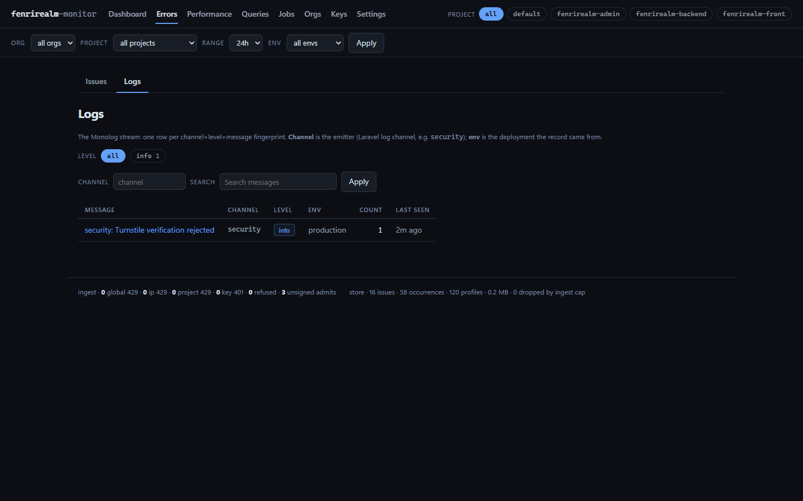 |
| Performance ▸ Endpoints — route-aggregated p50/p95/count | 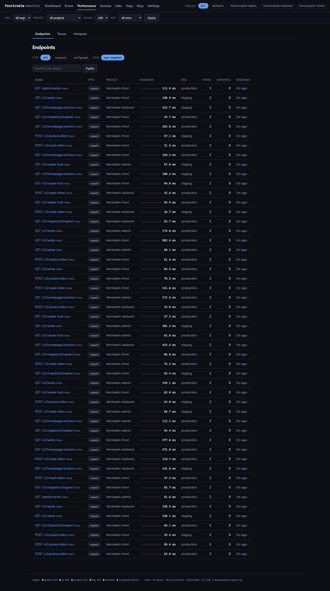 |
| Performance ▸ Traces — trace index with tree badge, deep-linkable | 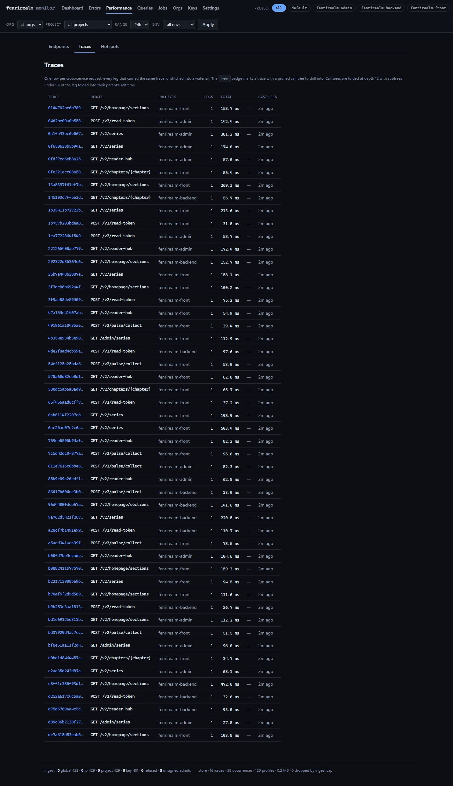 |
| Performance ▸ Hotspots — proportional bars, app-vs-framework | 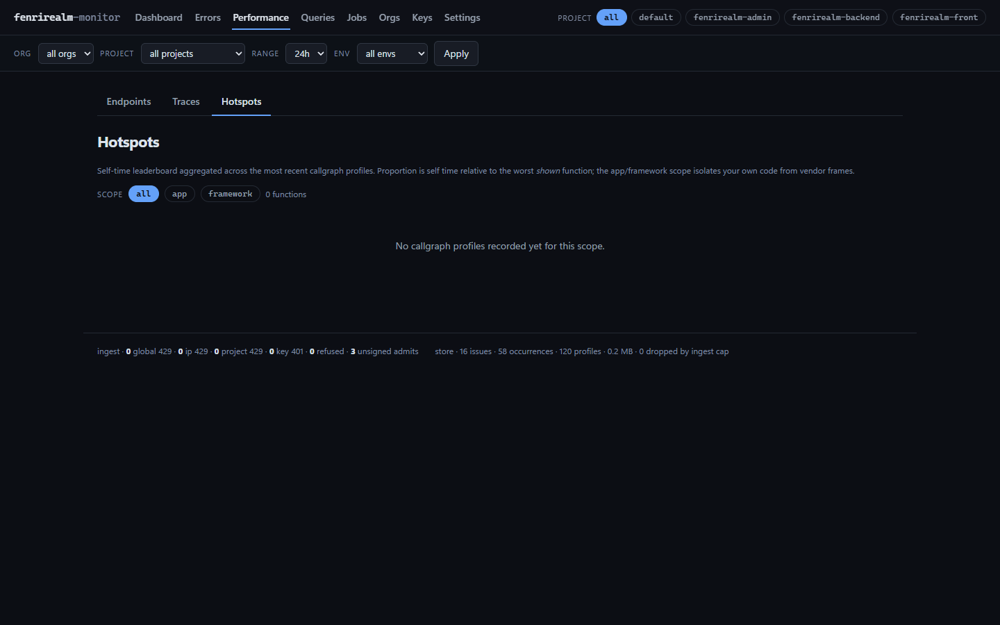 |
| Queries — fingerprint-grouped slow SQL | 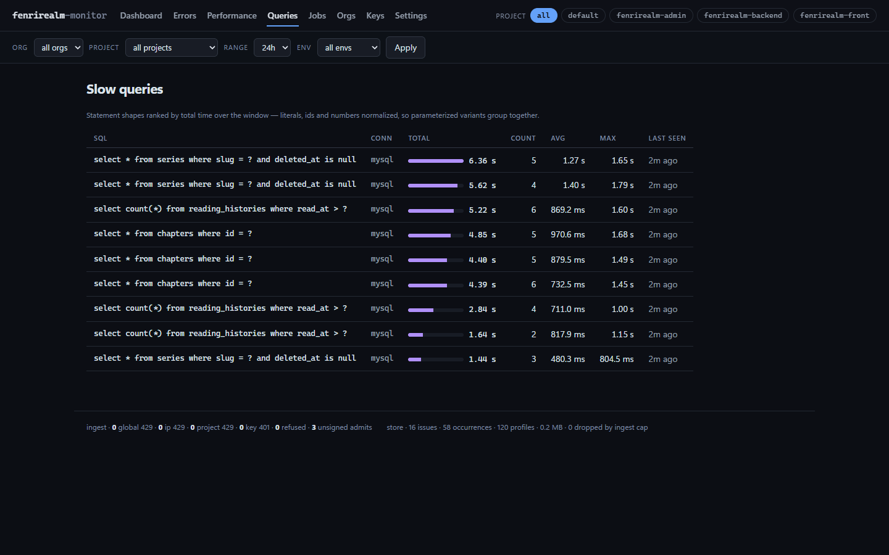 |
| Jobs — queue/command runs and heartbeats | 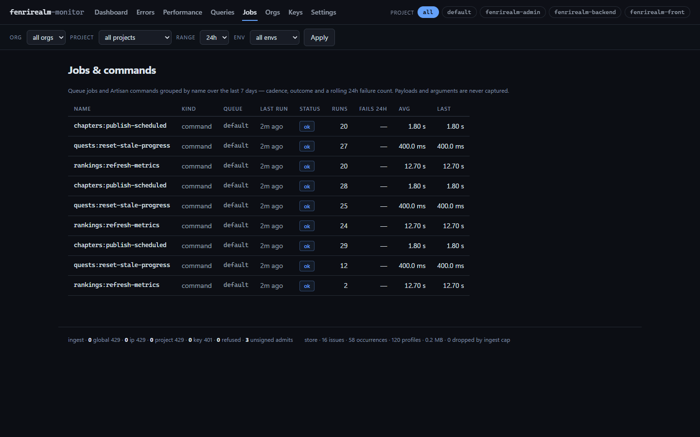 |
| Keys — per-project ingest keys, rotation and CORS origin | 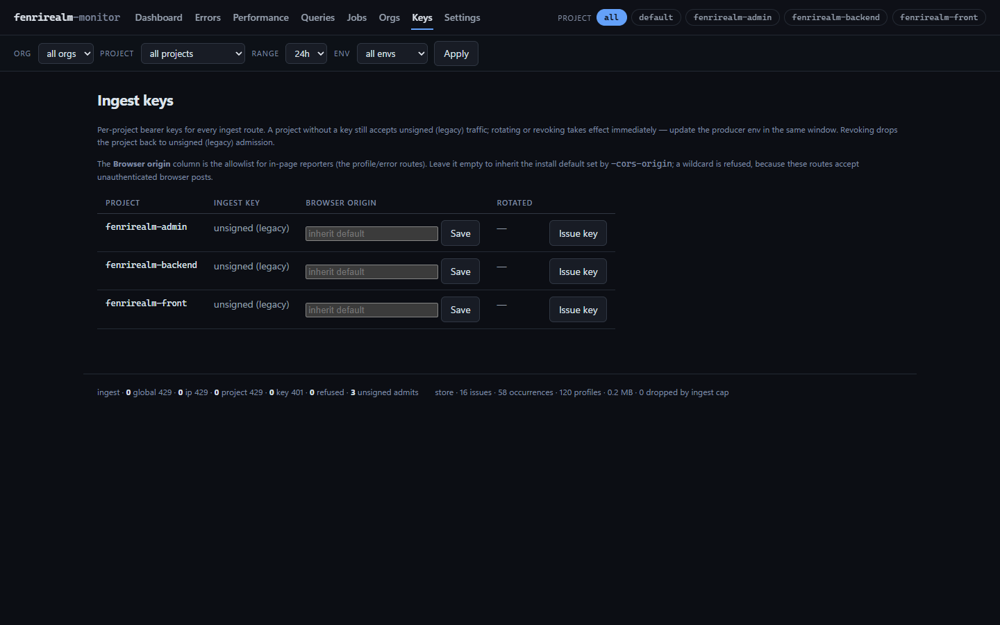 |
| Settings — retention, prune interval, per-project profile budget, per-project CORS origin | 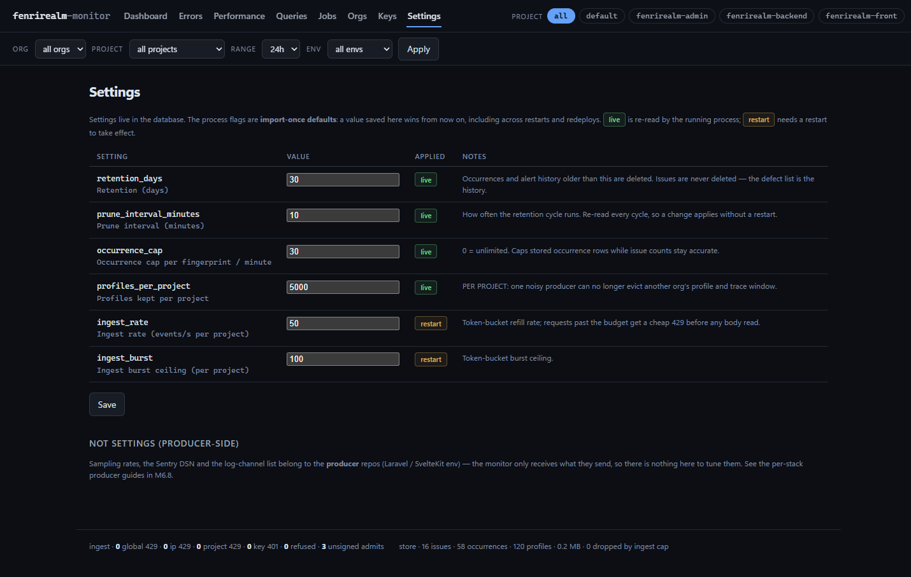 |
| Orgs — org/project grouping (M6.2) | 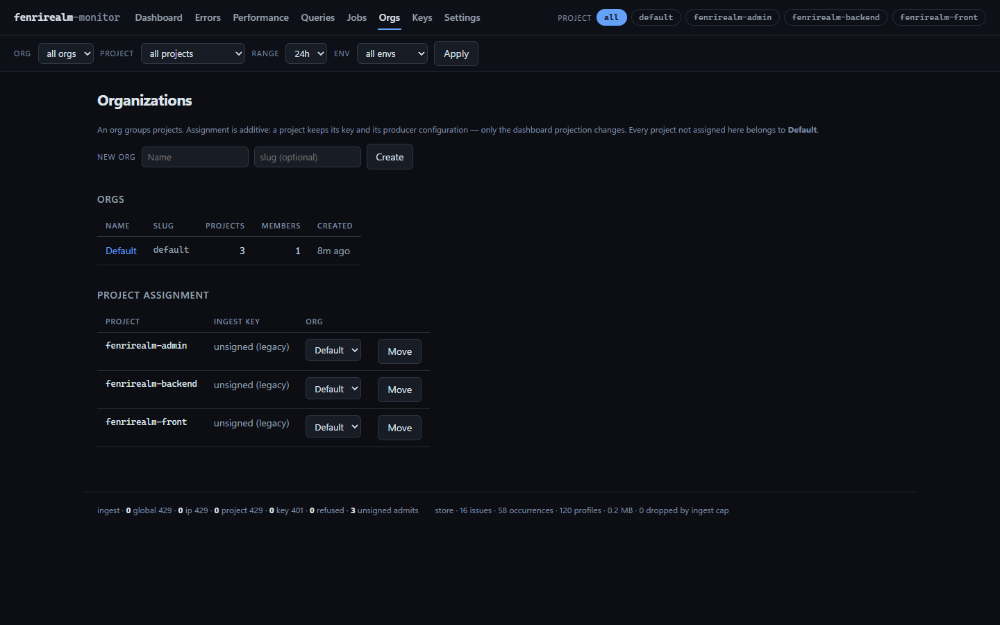 |

A **quickstart GIF** is still absent, and deliberately: the UI is server-rendered
with zero JavaScript, so there is no state transition worth animating — a slide
GIF of static screens would add megabytes and show nothing the gallery above does
not. The onboarding path is the README quickstart, and that is verified: a clean
directory, the real binary, the shipped container flags.

