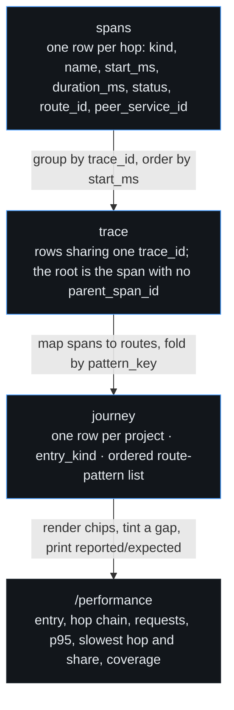

# Performance model

A journey is one end-to-end path: the ordered route patterns a single trace visited.
Read this before you instrument a producer, edit a grouping rule, or explain a coverage gap.
Payload shapes live in [WIRE_SPEC.md](../../WIRE_SPEC.md); this page is the model above them.

## Shape

Four layers. Only `spans` is written by ingest; everything above it is computed here.

### Spans and traces

- A span row is one leg: `kind`, `name`, `start_ms`, `duration_ms`, `status`, `route_id` and `peer_service_id`.
- `start_ms` is an offset from the payload's own start, never a wall clock. Skewed hosts still order.
- The payload's own span is the trace root: no parent, `start_ms` 0.
- A trace is every span sharing one `trace_id`. One root per trace, or the trace has no entry.
- Span kinds are open vocabulary; `internal` is the default when a producer names none.

### Hops

- Only a span with a route becomes a hop. A span naming neither route nor peer is dropped.
- A client span whose call another span answered is dropped: the callee measures the same wait.
- A client span with no child is an `unreported` hop, named after its route, else its peer service.
- Hop statuses are `ok`, `error` and `unreported`. An error is a slow hop, not a coverage gap.

### Journeys and coverage

- A journey's key is `sha256(project|entry_kind|patterns joined by ">")`, hex, first 32 characters.
- The project is prefixed because `pattern_key` is the unique upsert key; two tenants share `GET /`.
- Entry kinds are `api` (a server answered) and `page` (a browser rendered). Their owners differ.
- The journey's duration is the root span's `duration_ms`, falling back to the trace's span extent.
- Coverage is reported over expected: `2/3`, never a bare percentage. Every printed gap is named.
- Hotspot attribution reads profiles, keeps app frames by default, and `?frames=all` discloses the rest.

### Grouping — the other derived key

- The issue key is computed here, never taken from the producer.
- App frames are the frames that match none of the project's ignore globs. Defaults: `vendor/`, `node_modules/`, `/usr/local/go/src`, plus runtime frames.
- The bucket is the first two app frames as `module:function:file`, joined by ` -> `.
- The template is the message with uuids, then quoted strings, then digits replaced by `*`. Order matters.
- The key is `sha256(type|bucket|template)`, hex, first 32 characters.
- A producer fingerprint enters only through a project rule's `{{ default }}` token, never as the final key.
- `issues.group_source` records the path: `server`, `rule` or `producer`.
- Rules live per project in `settings` under `grouping:<project>` as JSON.

## Invariants

Each bullet names the test that goes red when the rule breaks.

- **A traceparent is adopted only from a trusted service.** An untrusted one is replaced by a minted id, because a payload's claim must not steer another service's trace. `TestTraceOriginReplacedForUntrustedService` (internal/ingest).
- **A malformed traceparent is minted past, never salvaged.** A guessed key groups unrelated requests. `TestTraceOriginMalformedTraceparentIsMinted`.
- **Absent context is minted, and the outcome is recorded.** `trace_origin` is stored on every span row. `TestTraceOriginMintedWhenNoTraceparent`.
- **A payload with no `service` is labelled with the project key.** That is the v1 rollout path, not a rejection. `TestServiceLabellingForV1Payload`.
- **`start_ms` is relative.** No join reads a wall clock, so no install needs clock sync. `TestSpanStartMsSurvivesRoundTrip` (internal/store).
- **A producer fingerprint never becomes the issue key.** A scheme change must not split history. `TestGroupingKeepsOneIssueAcrossProducerFingerprintChange` (internal/ingest).
- **Dependency and runtime frames never enter the bucket.** A framework bump would re-key every issue. `TestGroupingIgnoresDependencyFrames`.
- **A project rule wins over the computed key.** `TestGroupingRuleOverridesComputedKey`.
- **Materialisation is idempotent.** The same window twice updates rows instead of minting duplicates. `TestJourneyMaterialisationIsIdempotent` (internal/store).
- **A journey's p95 equals the direct aggregate over the same samples.** One percentile convention, not two. `TestJourneyP95MatchesDirectAggregate`.
- **An unanswered client span is a named gap.** It is never a blank and never a dropped row. `TestUnreportedHopBecomesGap`.
- **Coverage counts every hop.** A fully reported chain reports reported equal to total. `TestJourneyCoverageCompleteWithoutGaps`.
- **Entry kind separates a page render from an api call.** `TestJourneyEntryKindSplitsPageFromAPI`.
- **Hotspots keep app frames unless asked otherwise.** `TestJourneyHotspotAttributionKeepsAppFrames`.
- **A retried session beacon updates one row.** `(project, session_id)` is unique. `TestSessionHandlerRecordsOutcome` (internal/ingest).
- **The missed sweep stamps once.** One absence cannot alert twice. `TestSweepMissedRunMarksOnceAndAlertsOnce` (internal/alerts).
- **A re-delivered OTLP envelope counts no hop twice.** `TestOTLPResentEnvelopeIsIdempotent` (internal/ingest).
- **The v2 tables and their unique keys exist.** `TestSchemaV2TablesAndUniqueness` (internal/store).

## Failure modes

| Symptom | Cause | Check |
|---|---|---|
| Every journey is one hop, `service` equals the project name | the producer has not deployed the v2 identity | that stack's page under `docs/producers/` |
| One journey splits into two waterfalls | a side stopped propagating `traceparent`, or is untrusted and was replaced | `services.trusted_traceparent`, then the request page's `trace_origin` |
| A dashed hop naming a peer | an outbound call whose callee reported nothing | the callee's producer page; its span sender is off |
| A gap never appears though a callee is silent | the caller emitted no client span for that call | the caller's span flag |
| Journeys empty while ingest is busy | no span carried a route | the `route` field on the profile or error payload |
| p95 low on a route the fleet calls slow | hops past the 200-span payload cap were clipped | the clipped-batch note in the server log |
| Issue history splits after a deploy | a grouping rule or ignore list changed the key | `group_source` on the issue |
| The database grows without bound | nothing prunes `spans`, `journeys` or `sessions` | retention covers occurrences and profiles only |

## Operations

- The derived layer is `derivedLoop` in `cmd/monitor/main.go`: once at boot, then every 5 minutes.
- Each pass recomputes journeys over a trailing 15-minute window, then stamps missed scheduled runs.
- The window is wider than the tick, so a failed or slipped pass re-reads its overlap and leaves no hole.
- Both numbers are constants beside the loop. Change them there and restart; no flag and no setting exists.
- A pass reads `spans` once and upserts one journey per `pattern_key`, so a route rename lands next pass.
- A wider window is a full rebuild: `RecomputeJourneys(from, to)` is idempotent by its natural key.
- Alerts read the materialised rows, so an alert and the page cannot disagree about a chain.
- `span_unreported` fires from the journey gaps; `missed_run` fires from the sweep stamp, once.
- v2 is a breaking schema. `monitor --fresh` drops and recreates the database; see [DEPLOY.md](../../DEPLOY.md).
- Gates: `go test ./...` here, and the producer's own suite in its repository.
